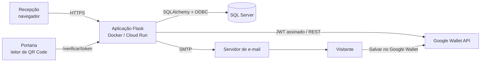
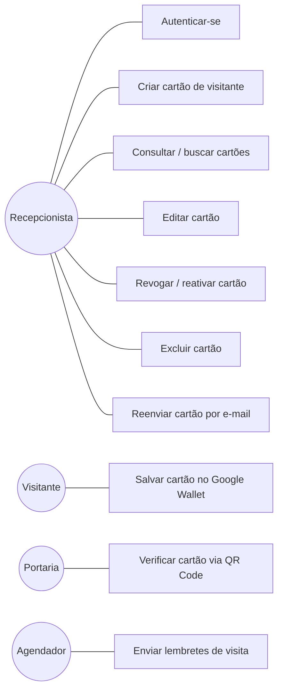
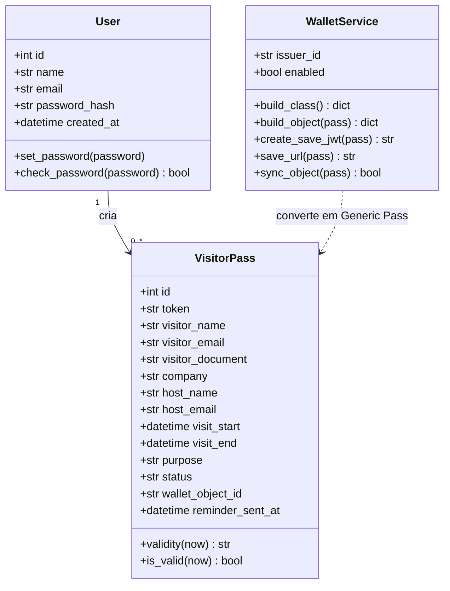
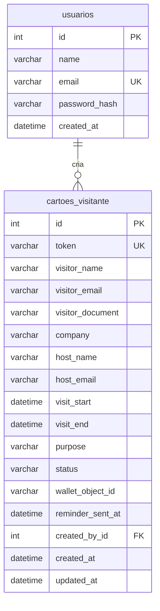

# Cartões de Visitante com Google Wallet

Sistema web para **automatizar a criação e a gestão de cartões de visitante** usando a
[Google Wallet API](https://developers.google.com/wallet). A recepção cadastra a visita, o
sistema gera um cartão digital (com QR Code e período de validade) e envia ao visitante um
link para salvá-lo no Google Wallet do celular. Na portaria, a leitura do QR Code indica se
o acesso está liberado.

Projeto desenvolvido como Trabalho de Conclusão de Curso (Engenharia de Software – UniCesumar).

## Funcionalidades

| Funcionalidade | Descrição |
|---|---|
| Autenticação | Login da recepção (Flask-Login, senhas com hash) |
| Criação de cartões | Cadastro de visitante, anfitrião, período e motivo da visita |
| Integração Google Wallet | Gera o link "Adicionar ao Google Wallet" (JWT assinado) e atualiza o cartão na carteira quando ele é editado ou revogado |
| Gestão de cartões | Listagem com busca e filtro por situação, visualização, edição, revogação/reativação e exclusão |
| Notificações | E-mail ao visitante na criação e lembrete automático para visitante e anfitrião antes da visita |
| Verificação de acesso | Página pública `/verificar/<token>` e API `/api/verificar/<token>` (JSON) para leitores de QR Code/catracas |
| Armazenamento seguro | SQL Server, tokens aleatórios de 128 bits, proteção CSRF, área administrativa autenticada |

## Tecnologias

- **Python 3.12+** e **Flask 3** (backend e telas com Jinja2)
- **SQL Server 2022** (via SQLAlchemy + pyodbc); SQLite para desenvolvimento local
- **Google Wallet API** (Generic Pass) com `google-auth`
- **Docker** / Docker Compose em **Linux**
- **Google Cloud Platform**: Artifact Registry (imagens) e Cloud Run (hospedagem)
- **pytest** + GitHub Actions (testes automatizados)

## Arquitetura



Estrutura do código:

```
app/
├── __init__.py          # fábrica da aplicação (create_app)
├── config.py            # configurações via variáveis de ambiente
├── models.py            # User e VisitorPass (SQLAlchemy)
├── forms.py             # formulários e validações (Flask-WTF)
├── auth.py              # login/logout
├── passes.py            # CRUD de cartões, QR Code e verificação pública
├── commands.py          # flask init-db | create-admin | send-reminders
├── services/
│   ├── wallet.py        # integração com a Google Wallet API
│   └── notifications.py # e-mails e lembretes
├── templates/           # telas (Jinja2)
└── static/style.css
tests/                   # testes automatizados (pytest)
```

### Diagrama de casos de uso



### Diagrama de classes



### Modelo de dados



## Como executar localmente (sem Docker)

Requisitos: Python 3.12 ou superior.

```bash
python -m venv .venv
# Windows: .venv\Scripts\activate   |   Linux/macOS: source .venv/bin/activate
pip install -r requirements-dev.txt
cp .env.example .env            # ajuste os valores se quiser

flask init-db                   # cria as tabelas (SQLite por padrão)
flask create-admin              # cria o usuário da recepção
flask run                       # http://localhost:5000
```

Sem credenciais do Google o sistema funciona em **modo demonstração**: os cartões são criados
e verificados normalmente e a tela mostra o JSON que seria enviado à Google Wallet API, mas o
botão "Adicionar ao Google Wallet" só aparece depois da configuração abaixo. Sem `MAIL_SERVER`,
os e-mails aparecem apenas no log.

## Como executar com Docker + SQL Server

```bash
docker compose up --build
docker compose exec app flask create-admin
# acesse http://localhost:8080
```

O `docker-compose.yml` sobe um SQL Server 2022 e a aplicação. O comando `flask init-db`
roda na inicialização do contêiner e cria o banco `visitantes` e as tabelas.

## Configurando o Google Wallet

1. Crie uma conta de emissor no [Google Pay & Wallet Console](https://pay.google.com/business/console)
   e anote o **Issuer ID**.
2. No [Google Cloud Console](https://console.cloud.google.com/), ative a **Google Wallet API**.
3. Crie uma **conta de serviço** e baixe a chave JSON para `credentials/service-account.json`
   (a pasta está no `.gitignore`, então a chave **nunca** é enviada ao GitHub).
4. No Pay & Wallet Console, em *Users*, adicione o e-mail da conta de serviço com permissão de **Developer**.
5. No `.env`, preencha:
   ```
   WALLET_ISSUER_ID=3388000000000000000
   GOOGLE_APPLICATION_CREDENTIALS=credentials/service-account.json
   ```

Enquanto a conta de emissor estiver em modo de teste, apenas os usuários de teste cadastrados
no console conseguem salvar os cartões.

## Lembretes automáticos

O comando abaixo envia lembretes das visitas que começam nas próximas `REMINDER_HOURS_BEFORE`
horas (padrão 24 h). Cada visita recebe só um lembrete.

```bash
flask send-reminders
```

Agende-o com `cron` (Linux) ou com o **Cloud Scheduler** + Cloud Run Jobs (GCP), por exemplo a cada 30 minutos.

## Deploy no Google Cloud (Artifact Registry + Cloud Run)

```bash
PROJECT=seu-projeto REGION=southamerica-east1
gcloud artifacts repositories create visitantes --repository-format=docker --location=$REGION
gcloud auth configure-docker $REGION-docker.pkg.dev

docker build -t $REGION-docker.pkg.dev/$PROJECT/visitantes/app:1.0 .
docker push $REGION-docker.pkg.dev/$PROJECT/visitantes/app:1.0

gcloud run deploy visitantes \
  --image $REGION-docker.pkg.dev/$PROJECT/visitantes/app:1.0 \
  --region $REGION --allow-unauthenticated \
  --set-env-vars "DATABASE_URL=...,WALLET_ISSUER_ID=...,BASE_URL=https://..."
```

Em produção, guarde a chave da conta de serviço e a senha do banco no **Secret Manager**.

## Testes

```bash
pytest -q
```

Os testes cobrem autenticação, CRUD de cartões, validações, busca/filtros, QR Code,
verificação pública, lembretes e a geração do JWT assinado para o Google Wallet.

## Rotas principais

| Método | Rota | Descrição |
|---|---|---|
| GET/POST | `/login` | Autenticação |
| GET | `/` | Lista de cartões (busca `q`, filtro `situacao`) |
| GET/POST | `/cartoes/novo` | Criar cartão |
| GET | `/cartoes/<id>` | Detalhes e link do Google Wallet |
| GET/POST | `/cartoes/<id>/editar` | Editar |
| POST | `/cartoes/<id>/revogar` · `/reativar` · `/reenviar` · `/excluir` | Ações |
| GET | `/verificar/<token>` | Verificação pública (QR Code) |
| GET | `/api/verificar/<token>` | Verificação em JSON |
| GET | `/saude` | Health check |
